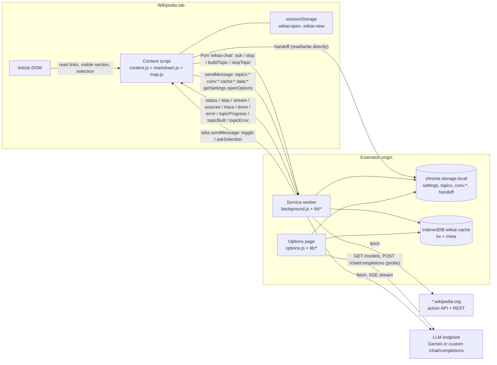

# Wiki AI: architecture

Snapshot of commit `db7f2d6` (version 0.3.0), written for the pre-publication review. Plain JavaScript, no build step, no package manager. Line numbers refer to that commit; since then page reading and highlighting moved to `content/page.js`, the phrase tables to `content/phrases.js`, the system prompt to `lib/prompt.js` and shared helpers to `lib/text.js` (see `ACTION_PLAN.md`).

## Platform

- **Manifest V3**, confirmed: `manifest.json:2` (`"manifest_version": 3`), background is a `service_worker` (`manifest.json:24-26`).
- No bundler, no transpiler, no `package.json`. Files are loaded as-is: the service worker uses `importScripts` (`background/background.js:2-15`), the content script is a list of files in the manifest (`manifest.json:44-56`), the options page uses `<script>` tags (`options/options.html:108-113`).
- Each `lib/*.js` file is an IIFE that adds a namespace to `globalThis.WikiAI` (`W.settings`, `W.llm`, `W.agent`…). The same files run in the service worker, the options page, and Node (tests load them with `vm.runInThisContext`).
- The only third-party code is vendored KaTeX 0.19.0 (`vendor/katex/`, MIT, ~270 KB JS + ~300 KB fonts).

## Entry points

| Entry point | File(s) | Runs in | Role |
|---|---|---|---|
| Service worker | `background/background.js` + all 12 `lib/*.js` files | Extension origin | Runs the agent (Wikipedia + LLM requests), topic building, storage API for the sidebar, context menu, toolbar action, keyboard command |
| Content script | `vendor/katex/katex.min.js`, `content/markdown.js`, `content/map.js`, `content/content.js` | Isolated world on `https://*.wikipedia.org/wiki/*`, `document_idle` | The sidebar (open shadow DOM), page reading (links, visible section, selection), citation highlighting, map view, history view |
| Options page | `options/options.html`, `options/options.js` + `lib/settings.js`, `cache.js`, `llm.js`, `topics.js`, `conversations.js` | Extension origin, opens in a tab | Provider, key, endpoint, models, language, budgets; storage stats and delete buttons |
| Popup / side panel / offscreen document | none | | The sidebar is injected into the page, not `chrome.sidePanel` |

`web_accessible_resources` (`manifest.json:58-71`) exposes the sidebar CSS, KaTeX CSS and fonts, and two SVGs to `https://*.wikipedia.org/*` because the content script loads them by URL from inside the page.

## Communication

- **Long-lived port** `wikiai-chat` (`content/content.js:1455-1474`, `background/background.js:27-77`): one per tab, opened lazily on the first question or topic build. Carries one chat run and one topic build at a time; a new `ask` aborts the previous one. Port disconnect aborts both.
- **One-shot messages** (`background/background.js:79-92`): `topics:*`, `conv:*`, `cache:*`, `data:*` are routed to `W.topics.handle` (`lib/topics.js:127-147`), which falls through to `W.conversations.handle` (`lib/conversations.js:102-111`). `getSettings` returns model names, `hasKey` and the answer language, never the key.
- **Background → tab**: `toggle` (toolbar button, Alt+Shift+W) and `askSelection` (context menu) via `chrome.tabs.sendMessage` (`background/background.js:94-117`).
- **Options page** does not go through the service worker; it calls `W.topics.handle` and `W.settings.save` in its own context (`options/options.js:265-286`).
- There is no `onMessageExternal` and no `externally_connectable`, so web pages cannot message the extension.

## One chat turn

1. **Article detection** (`content/content.js:7-13`): the content script runs on `/wiki/*`, bails out unless `#mw-content-text .mw-parser-output` exists, `body.ns-0`, and not the Main Page. `lang` is the first label of the canonical URL's host; `title` is decoded from the canonical path.
2. **Page context** (`content/content.js:183-192`): `pageInfo()` collects every in-article link with its signals (navbox, infobox, hatnote, see-also), up to two context sentences and sections (`collectLinks`, 138-181), the categories, and the section on screen with up to 8 000 characters of its rendered text (`visibleSection`, 63-92). A selection becomes `quote`.
3. **Send** (`content/content.js:1549-1584`): the history is the chat's answered turns (stopped or failed questions dropped; sentences the source check flagged removed from old answers), plus the chat-wide `sources` array and the active topic id. Posted on the port as `ask`.
4. **Service worker** (`background/background.js:59-71`): loads settings (throws if no key and provider isn't custom), loads the topic, calls `W.agent.run`.
5. **Retrieval** (`lib/agent.js:659-683`, `lib/wiki.js:122-209`):
   - `getIndexedPage` fetches the article twice in parallel: the plain-text extract (`action=query&prop=extracts&explaintext`) and the HTML (`action=parse`), plus Commons `imageinfo` for its figures. Tables, infoboxes and figures are pulled from the HTML with regexes (`lib/tables.js`). Results are cached in IndexedDB for 24 h.
   - The extract is split on `== Heading ==` into sections (references, external links and similar are dropped, `lib/wiki.js:5-8`), then into ~160-word chunks at sentence boundaries; table rows and figures become extra chunks (`chunkPage`, 55-117). A BM25 index is built over chunks (`lib/bm25.js`) and kept in memory (60 entries).
   - With a topic, all topic articles (extract only, no HTML) are fetched with 6 in parallel and merged into one BM25 corpus (`lib/topics.js:102-124`).
6. **Prompt** (`lib/agent.js:340-400`, 494-501):
   - System prompt: rules, the topic map, the outline, the introduction chunks (12% of budget) and the visible section's text (12%), each chunk numbered as a citable source.
   - User message: the question (and selection), then "Context gathered automatically": passages from articles the question names (`otherArticleHints`), BM25 passages from the article or topic, and BM25-ranked candidate links. "Read next" questions get a ranked recommendation list instead.
   - Budget: `contextFor` (`lib/settings.js:59-64`), 32k tokens for Gemini, 16k otherwise, estimated as characters / 3.5. `fit()` shortens old tool results, then moves old turns into a digest in the system prompt (`lib/agent.js:575-600`).
7. **AI call and tool loop** (`lib/agent.js:687-763`, `lib/llm.js`): streamed `POST {baseUrl}/chat/completions` with tools (`search_article`, `read_section`, `find_linked_articles`, `linked_article_summary`, `search_linked_article`, `recommend_reading`, plus `search_topic`, `topic_connections` with a topic). Up to `maxSteps` rounds (3 on Gemini), then a forced "answer now" round without tools. 429/503 switches to the fallback model; 429 without a fallback waits 10/30/60 s or the server's `retryDelay`.
8. **Answer checks** (`lib/agent.js:695-728`, `lib/grounding.js`):
   - An all-reasoning reply is retried once without thinking.
   - A reply that sends the reader elsewhere is retried once with "open it yourself".
   - The source check flags sentences with numbers or capitalised names that appear in no source; one rewrite is requested. What is still flagged after that is shown underlined.
9. **Streaming**: only the model's reasoning streams to the panel. The answer text is held back and sent once with `done`, after the source check (`draft()`, `lib/agent.js:602-610`).
10. **Rendering** (`content/content.js:1279-1406`, `content/markdown.js`): an escape-first Markdown subset (paragraphs, lists, headings, bold, italic, code), KaTeX for `$…$`/`$$…$$`, citation markers `[n]` turned into buttons only when `n` is an existing source, renumbered 1..k per answer. Sources are grouped by page under the answer; cited images are shown with credit. Re-render is a full `innerHTML` replace, throttled to 40 ms.
11. **Citation linking** (`content/content.js:229-324`, 1605-1613): a source from the current page is found in the live DOM by text matching (first sentences, then the tail) or, for tables/infoboxes/figures, by row values, labels or file name; it is highlighted with the CSS Custom Highlight API. Otherwise a preview opens with a link to `https://{lang}.wikipedia.org/wiki/{title}#:~:text={first 6 words}`.
12. **Follow-ups**: parsed from the answer's `<followups>` block, filtered against asked questions; if fewer than two, one more model call (`lib/agent.js:546-572`).
13. **History save** (`content/content.js:1502-1508`, `lib/conversations.js:42-50`): on `done`/`error` the whole conversation object is sent with `conv:save`; the worker trims sources to 700 characters and drops streaming-only fields, keeps 12 chats per scope and 40 scopes.

## Topic cluster build

`lib/cluster.js:124-218`: rank the page's links (no model) → `linkStats` for disambiguation and back-links → one JSON-mode model call that returns themes as candidate numbers (one retry on bad JSON, one "fuller" retry for long articles) → optional Wikipedia searches → `resolveTitles` → a REST summary per article (6 parallel) → `linksBetween` for edges → saved to `chrome.storage.local` and made active.

## State

| Where | Key / store | Contents | Written by | Limits |
|---|---|---|---|---|
| `chrome.storage.local` | `settings` | provider, `baseUrl`, models, **`apiKey` and `apiKeys` (per provider, plaintext)**, `connections`, budgets, language | options page | none |
| `chrome.storage.local` | `topics` | one object holding every topic: id, name, lang, seed, facets, pages (title, facet, description, 280-char summary), edges | worker, options | **no cap** |
| `chrome.storage.local` | `activeTopic` | topic id | worker | |
| `chrome.storage.local` | `conv:<scope>` (`topic:<id>` or `page:<lang>:<title>`) | up to 12 chats: messages (questions, answers, steps, follow-ups, flagged sentences, selection quotes), all sources with text trimmed to 700 chars and figure metadata | worker | 12 per scope |
| `chrome.storage.local` | `conv:index` | scope → last-used time | worker | 40 scopes |
| `chrome.storage.local` | `handoff` | up to 5 recent `{path, view, chat, scope, at}` for opening the panel in a new tab | content script directly | 2-minute expiry on read |
| IndexedDB `wikiai-cache` (extension origin) | `kv`, `meta` | Wikipedia extracts, parsed HTML parts, summaries; write time | worker, options | 24 h TTL, 300 entries, pruned every 50 writes |
| Page `sessionStorage` (wikipedia.org origin) | `wikiai:open`, `wikiai:view` | panel open/closed and section | content script | per tab |
| Service-worker memory | `indexes` (`lib/wiki.js:197`), `memory` (`lib/cache.js:9`), `corpora` (`lib/topics.js:102`), per-port `controller`/`building` | BM25 indexes, hot cache, topic corpus, abort controllers | worker | lost when the worker stops; rebuilt on demand |
| Content-script memory | `state` (`content/content.js:16-36`), `traces` WeakMap | open chats, active topic, view, debug traces | content script | per page load |

No `chrome.storage.sync` or `chrome.storage.session` is used.

## External services

| URL | From | Purpose | Data sent |
|---|---|---|---|
| `https://{lang}.wikipedia.org/w/api.php` (`action=query` extracts/info/links/pageprops/description/imageinfo/search, `action=parse`) | worker | Article text, HTML for tables/figures, redirects, link graph, image metadata | Article titles, search strings chosen by the model or cluster prompt |
| `https://{lang}.wikipedia.org/api/rest_v1/page/summary/{title}` | worker | Introductions of linked and topic articles | Titles |
| `https://upload.wikimedia.org/...` (thumbnail URLs from `imageinfo`) | page (via `` in the sidebar) | Images shown with answers | Normal image request from the Wikipedia page |
| `https://generativelanguage.googleapis.com/v1beta/openai/chat/completions` and `/models` | worker, options | Default model provider (Gemini, OpenAI-compatible API) | API key (Bearer), system prompt with article text, the question, selected text, chat history, tool results |
| User-configured `{baseUrl}/chat/completions` and `/models` (any `http(s)` host after a permission prompt; `localhost`/`127.0.0.1` granted at install) | worker, options | Alternative provider | Same as above |
| `https://aistudio.google.com/apikey` | link in the options page | Where to get a key | nothing (a link) |
