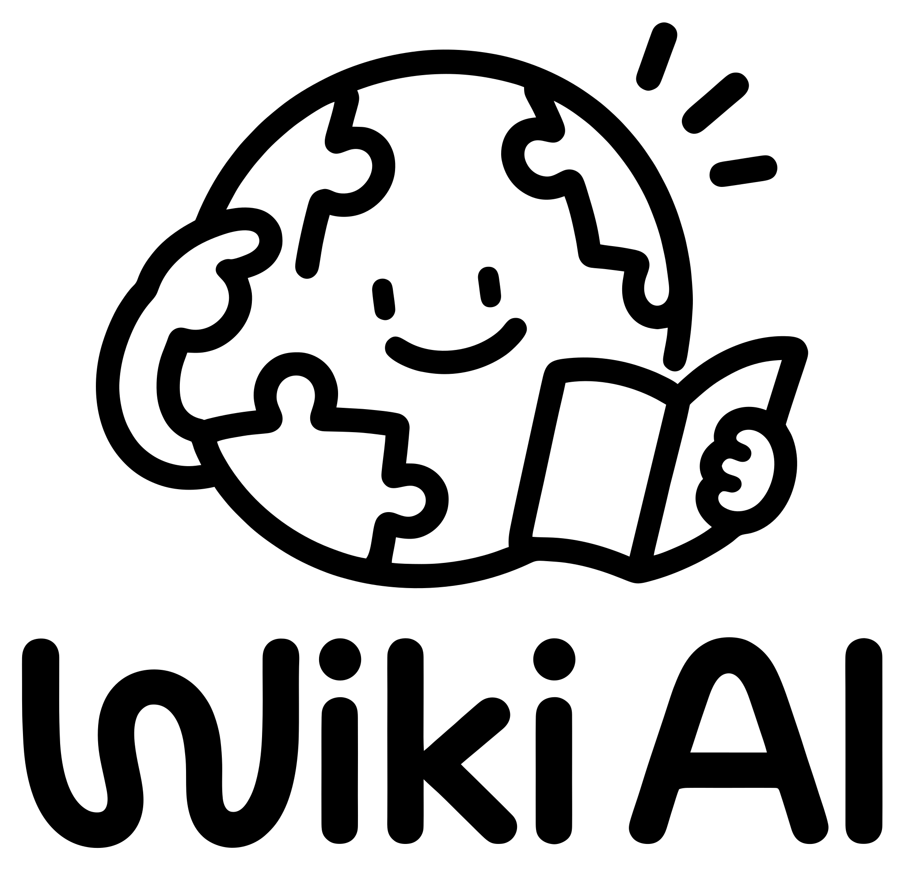

<p align="center">
  <picture>
    <source media="(prefers-color-scheme: dark)" srcset="icons/logo-dark.svg">
    
  </picture>
</p>

# Wiki AI

> Wiki AI is an independent project. It is not affiliated with, endorsed by or sponsored by Wikipedia or the Wikimedia Foundation. Wikipedia is a trademark of the Wikimedia Foundation.

A browser extension (Chrome and Safari) that adds a chat sidebar to Wikipedia articles. You can ask about the article you're reading and the articles it links to. It works with Google Gemini (free API key) or any OpenAI-compatible endpoint, including models you run yourself.

## What it does

- **Answers from the article, with citations.** Every claim gets a numbered source. Click one: if it's from the current article, the passage is highlighted in the page and scrolled into view. If it's from a linked article, a preview opens with a link that jumps to the passage.
- **Follows links.** The model can find relevant linked articles (by their title, link text and the sentence they appear in), read their introductions, and search inside them.
- **Ask about selected text.** Select a passage and click **Ask about this**, or right-click → *Ask Wiki AI about "…"*.
- **Knows where you are.** The section you're scrolled to is added to the prompt, so "explain this section" works.
- **Topic clusters across many articles.** Click **Build topic cluster** and the model groups the article's most relevant links into themes, e.g. *House of Oldenburg* → Danish line, cadet branches, origins. The cluster stays active as you browse its articles, and questions then search every article in it at once. You can add or remove articles, and switch between saved topics.
- **Three sections: Chat, Topic, Map.**
  - **Chat**: the conversation, with **History** (saved chats for this topic or article: reopen or delete) and **New chat**.
  - **Topic**: the active topic's themes and articles, saved topics, and **Questions to explore**.
  - **Map**: the topic's articles as a graph (colored by theme, sized by connections, lines for links). Click an article for its summary, open it, or ask about it; enlarge the map over the article area.
- **Suggested next questions.** Every answer ends with three follow-up questions. Clicking one continues the same chat; asked ones get a ✓. Suggestions you haven't asked yet, from all your chats, collect under **Topic › Questions to explore**, and asking one there continues the chat it came from.
- **Falls back automatically.** If the main model is unavailable or rate-limited, it retries on the fallback model set in the settings.

The sidebar opens on every Wikipedia article. Close it with × (it stays closed in that tab) and reopen it with the round button (bottom right), the toolbar icon, or **Alt+Shift+W**.

## How it works

```
content/content.js   sidebar (shadow DOM), link + context extraction from the page DOM,
                     citation highlighting (CSS Custom Highlight API), selection button
background/          service worker: runs the agent per question over a runtime port
lib/wiki.js          Wikipedia API: plain-text article split into sections → ~160-word chunks,
                     plus its tables, infobox and images (with Wikimedia Commons details);
                     REST summaries; cached 24 h in IndexedDB
lib/tables.js        tables, infoboxes and images from the article HTML as text (the extract drops them)
lib/bm25.js          keyword search over chunks and over links (no embedding model needed)
lib/agent.js         tool-calling loop, prompt budget, numbered sources
lib/llm.js           streaming OpenAI-compatible client (tool calls, <think> handling, 503 fallback)
lib/cluster.js       builds a topic cluster: rank links → model groups them into themes → check titles
lib/topics.js        saved topics, search across a topic's articles, message API for the sidebar
```

### How a topic cluster is built

1. **Candidates, no model:** every link on the page is scored by where it appears: navigation boxes (a topic's member list), "Main article:" notes, the infobox, the introduction, and how often it is linked. The top 80 are kept.
2. **One model call:** the model gets the introduction, the outline and the numbered candidates, and returns themes as lists of candidate **numbers**, so it can't invent article titles. For a missing theme it can suggest a Wikipedia search instead.
3. **Check, no model:** every title is resolved through the Wikipedia API (redirects followed, missing articles dropped). Then each article's one-line description is fetched, and the links between the topic's articles are mapped.

With a topic active, the model gets the topic map (themes, articles, descriptions) and two extra tools: `search_topic` (one search across all topic articles, at most two passages per article so no single article dominates) and `topic_connections` (how one article links to the others, with the citable sentences).

### Storage

| What | Where | Size and lifetime |
|---|---|---|
| Saved topics (titles, themes, short summaries, links between pages) | `chrome.storage.local` | ~20–60 KB per topic, kept until you delete it; 50 at most (least recently changed dropped, with their chats) |
| Wikipedia article text and summaries | IndexedDB cache | expires after 24 h, capped at 300 entries (oldest removed first) |
| Saved chats (messages; cited sources trimmed to 700 characters, uncited ones without text) | `chrome.storage.local` | 12 per topic or article, 40 topics/articles at most, and storage kept under 8 MB (least recently used dropped) |
| Search indexes | memory only | rebuilt as needed |

The settings page shows current usage and has a button to clear the cache.

Context stays small because the model pulls in text through tools rather than getting the whole article:

| Always in the prompt | Fetched by tools when needed |
|---|---|
| Article outline and introduction | `search_article`, `read_section` |
| The section you're reading | `find_linked_articles` |
| Your selected text | `linked_article_summary` |
| Top passages and candidate links for the question, found automatically | `search_linked_article` |

Prompt budgets per model are in `lib/settings.js` (`contextFor`): 32k tokens for Gemini, 16k otherwise. Set **Context tokens** in the settings to use more with a model that reads fast.

## Install

### Chrome
1. `chrome://extensions` → turn on **Developer mode** → **Load unpacked** → pick this folder.
2. Open the extension's **Options** and pick where answers come from:
   - **Google Gemini**: paste a free key from [aistudio.google.com/apikey](https://aistudio.google.com/apikey).
   - **Other provider**: enter the endpoint address and key under **Advanced connection**.
3. Click **Test connection** (for your own server, allow Wiki AI to reach it when the browser asks), then **Save**.

### Safari
```bash
xcrun safari-web-extension-converter . --project-location ../wiki-ai-safari --app-name "Wiki AI" --macos-only
```
Open the generated Xcode project, choose your Apple ID team under *Signing & Capabilities*, and run it. Then enable it in Safari → Settings → Extensions and allow it on wikipedia.org. Requires Safari 17.4+.

The key is stored only in the browser's extension storage. Plain `http://` endpoints are accepted only on this computer or the local network.

### Chrome Web Store build
```bash
scripts/package.sh --store
```
This writes `dist/wiki-ai-<version>-store.zip` (manifest at the root, no tester guide). The listing text is in `STORE_LISTING.md`; the privacy policy is `PRIVACY.md`.

## Testing

**Unit tests and lint** (no network, no model; also run on every push by GitHub Actions):
```bash
npm install
npm test
npm run lint
```

**Agent against the real model, from the terminal:**
```bash
export LLM_API_KEY=…                       # a Gemini key, or your endpoint's key
export LLM_BASE_URL=https://…/v1           # leave unset for Gemini
node test/agent-cli.mjs "Ada Lovelace" "Who was her mother and what was she known for?" [model]
```

It prints each source check (`[grounding]`): numbers and names in the answer that aren't in any source the model read.

**Source check on known answers** (no model needed):
```bash
node test/grounding-check.mjs
```

**Tables, infoboxes and images read from article HTML** (no model needed):
```bash
node test/tables-check.mjs
```

**Topic cluster against the real model** (link signals are approximated from the HTML):
```bash
node test/cluster-cli.mjs "House of Oldenburg" [model] "How is the House of Oldenburg connected to Denmark, Greece and Russia?"
```

**Sidebar UI without installing the extension** (real Wikipedia retrieval, scripted fake model, no key):
```bash
mkdir -p test/fixtures && curl -s https://en.wikipedia.org/wiki/Ada_Lovelace | sed 's|<head>|<head><base href="https://en.wikipedia.org/">|; s|</body>|<script src="http://127.0.0.1:8765/test/harness.js"></script></body>|' > test/fixtures/ada.html
python3 -m http.server 8765 --bind 127.0.0.1
```
Then open http://127.0.0.1:8765/test/fixtures/ada.html.

## Known limits

- Small models sometimes answer from the introduction instead of opening a linked article. Larger models follow links more reliably.
- Highlighting finds passages by matching text. Passages with math or heavy templates fall back to scrolling to the section heading.
- English stopwords only. Other-language Wikipedias work, with slightly noisier keyword search.
